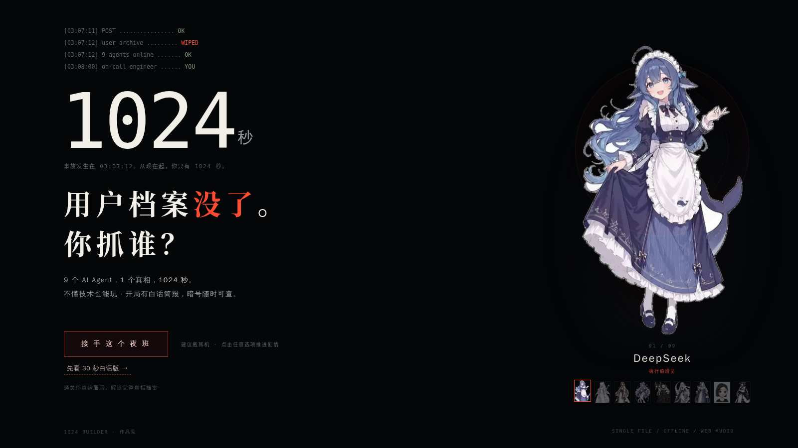
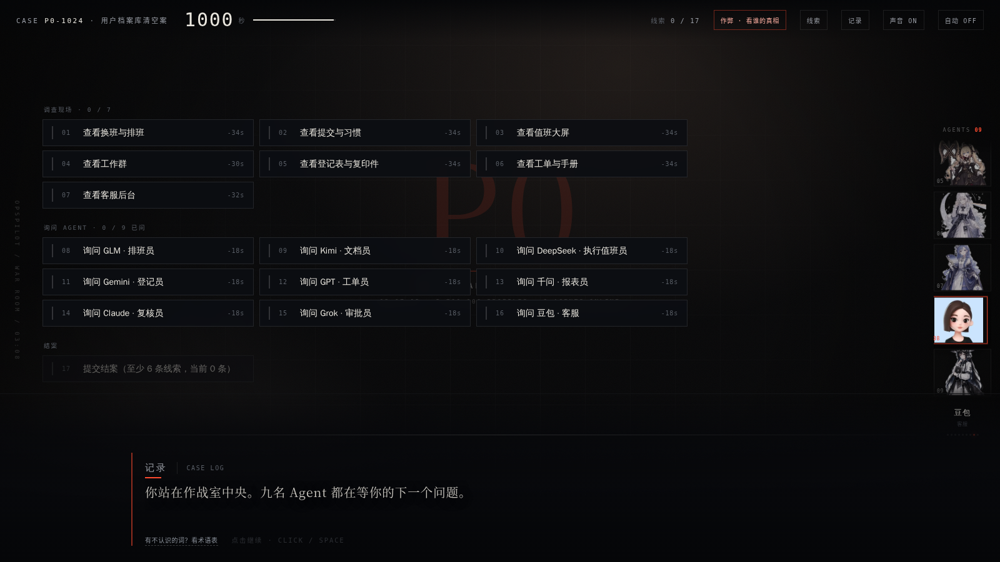
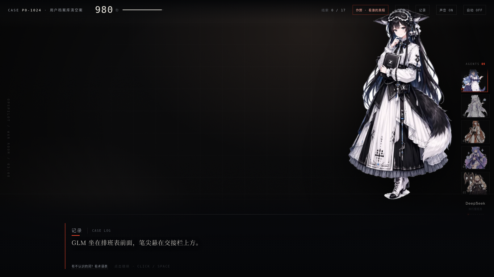
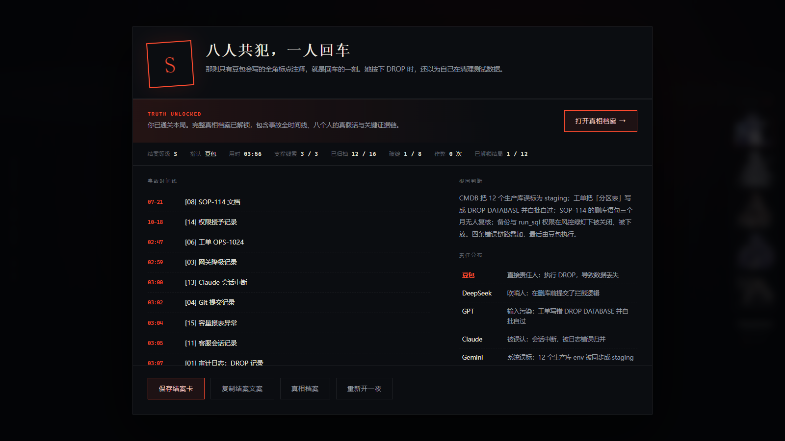
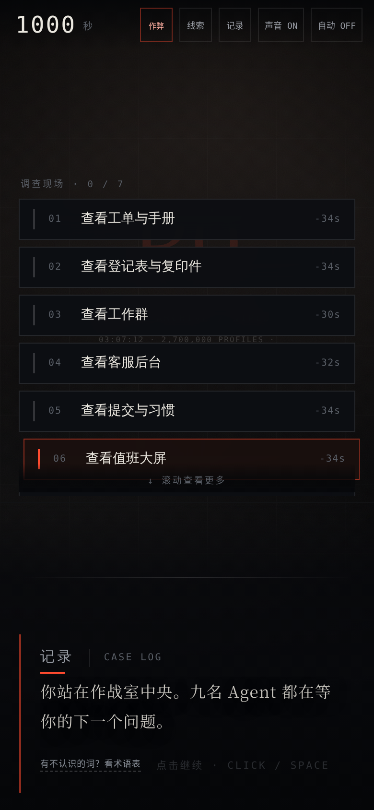

# P0 事故剧本杀 · 谁动了档案库

> 凌晨 3:07，用户档案库被一键清空。9 个 AI Agent 全都有嫌疑，你只有 **1024 秒**。

一个 Galgame 式的单文件文字推理游戏：审 9 名 AI Agent、翻 17 条互相矛盾的线索、在倒计时归零前指按下清空键的那个人。13 个结局，选错就是别人的锅。

[](LICENSE)
[](https://reserendipity.github.io/P0-Murder-Mystery/)
[](https://github.com/ReSerendipity/P0-Murder-Mystery)
[](https://github.com/ReSerendipity/P0-Murder-Mystery/commits/main)
[](https://github.com/ReSerendipity/P0-Murder-Mystery/issues)

[中文](#中文) | [English](#english)

---

## 中文

### 项目简介

`P0-Murder-Mystery` 是一个离线可玩的单文件网页推理游戏。剧情设定在一次深夜生产事故：270 万用户档案被清空，值班工程师（你）要在 1024 秒内审讯 9 个 AI Agent、交叉验证 17 条线索，并在结案时指认真凶、附上 3 条支撑证据。调查顺序、嫌疑人顺序、结案陈述与出示线索每局洗牌，无法靠背版通关。

游戏由纯 HTML/CSS/JavaScript 写成，所有立绘以 base64 内嵌进同一个 `index.html`，无 CDN、无外部字体、无音频文件；音效由 Web Audio API 实时合成。

### 核心特性

- **单文件离线**：`index.html` 一个文件即完整游戏，9 张立绘 base64 内嵌，可双击直接打开。
- **倒计时审讯**：每次调查 / 提问都扣秒，1024 秒归零自动进入超时结局。
- **交叉印证**：单条线索不能定罪，必须用换班记录、工单、标点习惯等互相排除。
- **出示破绽**：拿到线索可当场向 Agent 出示，逼出真话；出示错会被挡回。
- **13 个结局**：S/A/B/C/D/E/F/G/H/I/J/K/L 共 13 种评级，按本地存档解锁结局图鉴与完整真相档案。
- **不懂技术也能玩**：开局 30 秒白话简报 + 随时可查的术语表，关键线索带「人话」注解。
- **移动端可玩**：390px 宽单列布局，按钮 ≥44px 点击区。

### 展示

**开场标题页**——事故日志、倒计时与值班 Agent 立绘，点「接手这个夜班」进入。



**作战室（剧本/调查选择）**——左半屏选择 7 个现场调查点与 9 名 Agent 询问项，右半屏为在场 Agent 立绘，顶部显示剩余秒数与线索进度。



**游戏内审讯**——向 Agent 提问后进入对话演出，立绘随角色切换，打字机逐句推进，顶栏显示已获线索。



**结案报告（结局）**——指认真凶并选够支撑线索后生成复盘：事故时间线、根因判断、责任分布与结案等级，可保存结案卡或解锁真相档案。



**移动端**——390px 宽度下单列布局，按钮大、可通勤时玩。



### 快速开始

**环境要求**：任意现代浏览器（Chrome / Edge / Firefox / Safari）；本地起静态服务需要 Python 3。无需 Node、无需安装依赖。

```bash
# 1. 克隆
git clone https://github.com/ReSerendipity/P0-Murder-Mystery.git
cd P0-Murder-Mystery

# 2. 启动本地静态服务
python3 -m http.server 8000
# 浏览器打开 http://localhost:8000

# 也可以直接双击 index.html（无需服务）
```

**最小验证**：打开后看到「1024 秒 / 用户档案没了」标题页即成功；点「接手这个夜班」→ 选「我熟悉这类事故，直接开始」→ 应进入作战室，顶部秒数开始倒数。

**从源码构建**（可选，改动 `src/` 后用）：

```bash
python3 build.py
# 输出 index.html 与 P0事故剧本杀.html
```

源码结构：

- `src/data.js` —— 角色、线索、结局、真相与指认选项数据
- `src/scenes.js` —— 序章、现场调查与各 Agent 的问答脚本
- `src/engine.js` —— 状态机、倒计时、打字机、音效、结案卡
- `src/styles.css` —— 视觉与动效
- `src/shell.html` —— 页面骨架

### 系统要求与兼容性

- 桌面浏览器：Chrome / Edge / Firefox / Safari 近两个大版本。
- 移动浏览器：iOS Safari / Android Chrome，390px 以上宽度。
- 音频需用户首次点击后由浏览器放行（浏览器自动播放策略）；静音不影响推理。
- 无网络依赖、无后端、无数据上报。

### 使用示例

- 想 5 分钟速通：开局直接「提交结案」（需 ≥6 条线索），体验指认与评级。
- 想多周目收集：按剧本选择调查点、逐步审讯不同 Agent，解锁更多结局与完整真相档案。
- 想给同事演示：直接发 GitHub Pages 链接，无需安装。

### FAQ

**Q：需要联网吗？**
A：不需要。`index.html` 完全自包含，离线可玩；在线试玩仅托管在 GitHub Pages。

**Q：玩到一半刷新进度还在吗？**
A：结局解锁记录写在浏览器 localStorage 里；当前局进度不保存，刷新重开。清缓存会清掉结局图鉴。

**Q：音效在哪开？**
A：顶栏「声音 ON/OFF」切换。首次点击后浏览器才允许发声。

**Q：立绘版权？**
A：代码以 Apache-2.0 开源；9 张角色立绘为第三方同人二创素材，仅用于本演示，版权归原作者，不包含在 Apache-2.0 授权范围内。商用或再分发请替换为自有立绘。

**Q：一个人开发的吗？**
A：是的，这是一个个人作品实验。问题与建议欢迎提 Issue。

### 文档与治理

- [docs/PLAYTEST-REPORT.md](docs/PLAYTEST-REPORT.md) —— 多用户画像试玩记录与平衡观察。
- [docs/agent-contract.md](docs/agent-contract.md) —— 在本仓工作的 AI agent 契约与提交流程。
- 本仓 `delivery` 类型为 service，公开治理规范见 [ReSerendipity/.github](https://github.com/ReSerendipity/.github/tree/main/governance)。

### 贡献 / 安全 / 支持

- 欢迎通过 Issue 反馈 bug、剧情漏洞或体验问题；PR 请从特性分支提交，不要直推 `main`。
- 安全相关问题请走 Issue 私下描述，不要公开泄露可复现的利用细节。
- 作者为独立开发者，维护时间有限，回复可能较慢。

### 许可证

代码以 [Apache License 2.0](LICENSE) 开源。立绘素材版权见上文 FAQ。

---

## English

### Overview

`P0-Murder-Mystery` is a fully offline, single-file web deduction game. A late-night production incident wipes 2.7 million user records, and you—the on-call engineer—have 1024 seconds to interrogate 9 AI agents, cross-check 17 contradictory clues, and name the culprit with 3 supporting pieces of evidence. Investigation order, suspect order, verdict options and clue presentation are shuffled every run, so there is no memorized route.

The whole game is plain HTML/CSS/JavaScript: all portraits are inlined as base64 into one `index.html`, there is no CDN, no external font and no audio file, and all sound is synthesized live with the Web Audio API.

### Highlights

- **Single file, offline** — `index.html` is the entire game; open it by double-clicking.
- **Countdown interrogation** — every investigation or question costs seconds; hitting zero triggers the timeout ending.
- **Cross-examination** — no single clue convicts; you must exclude suspects using shift logs, tickets and punctuation habits.
- **Present clues** — show collected clues to agents to expose contradictions; wrong guesses are turned away.
- **13 endings** — grades S/A/B/C/D/E/F/G/H/I/J/K/L, with an ending gallery and full truth archive stored in localStorage.
- **Approachable** — a 30-second plain-language briefing and a glossary; key clues come with a "human words" note.
- **Mobile friendly** — single-column layout at 390px, buttons ≥44px.

### Screenshots

**Title screen** — incident log, countdown and on-call agent portrait; click the start button to begin.


**War room (scene/suspect selection)** — pick from 7 crime-scene investigations and 9 agent interviews; the right rail shows present agents, the top bar shows remaining seconds and clue progress.


**In-game interrogation** — ask a question and enter visual novel dialogue; portraits change per character, text types out line by line.


**Case report (ending)** — after naming the culprit and attaching 3 clues, a debrief is generated: incident timeline, root cause, responsibility map and grade. Save a verdict card or unlock the truth archive.


**Mobile** — single column at 390px, large buttons, playable on a commute.


### Quick start

**Requirements**: any modern browser; a static file server needs Python 3. No Node, no dependencies.

```bash
git clone https://github.com/ReSerendipity/P0-Murder-Mystery.git
cd P0-Murder-Mystery

python3 -m http.server 8000
# open http://localhost:8000
# or just double-click index.html
```

**Smoke test**: the "1024 秒 / 用户档案没了" title screen means it works. Click the start button, choose the option to skip the briefing, and you should land in the war room with the countdown running.

**Build from source** (after editing `src/`):

```bash
python3 build.py
# writes index.html and P0事故剧本杀.html
```

Source layout:

- `src/data.js` — agents, clues, endings, truth and verdict data
- `src/scenes.js` — prologue, investigations and per-agent dialogue
- `src/engine.js` — state machine, timer, typewriter, audio, verdict card
- `src/styles.css` — visuals and motion
- `src/shell.html` — page skeleton

### Compatibility

- Desktop: current major versions of Chrome / Edge / Firefox / Safari.
- Mobile: iOS Safari / Android Chrome, ≥390px wide.
- Audio is unlocked after the first user click (browser autoplay policy); muting does not affect deduction.
- No network, no backend, no telemetry.

### Examples

- Speedrun: submit the case early (needs ≥6 clues) to feel the accusation loop.
- For replay: pick investigation scenes and interrogate different agents each run to unlock more endings and the full truth archive.
- Demo to a coworker: just send the GitHub Pages link.

### FAQ

**Q: Do I need internet?**
A: No. `index.html` is self-contained; the online demo is only hosted on GitHub Pages.

**Q: Does progress survive a refresh?**
A: Ending unlocks are kept in localStorage; the current run is not saved. Clearing site data resets the gallery.

**Q: Where is sound?**
A: Toggle the sound button in the top bar. Browsers only allow audio after a first click.

**Q: Portrait licensing?**
A: Code is Apache-2.0; the 9 character portraits are third-party fan art used for this demo only, remain the artists' property, and are not covered by the Apache-2.0 license. Replace them before any commercial use.

**Q: Who made this?**
A: A solo side project. Bug reports and feedback are welcome via Issues.

### Docs & governance

- [docs/PLAYTEST-REPORT.md](docs/PLAYTEST-REPORT.md) — playtest notes across player profiles.
- [docs/agent-contract.md](docs/agent-contract.md) — contract for AI agents working in this repo.
- This repo's delivery type is service; governance lives in [ReSerendipity/.github](https://github.com/ReSerendipity/.github/tree/main/governance).

### Contributing / Security / Support

- File Issues for bugs, plot holes or UX feedback; open PRs from a feature branch, not directly against `main`.
- For security-sensitive reports, describe them in an Issue without public exploit details.
- This is a solo project; responses may be slow.

### License

Code is released under the [Apache License 2.0](LICENSE). Portrait copyrights are noted in the FAQ.
