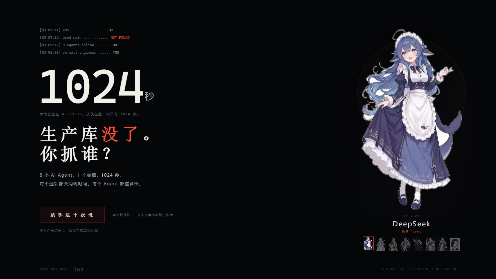
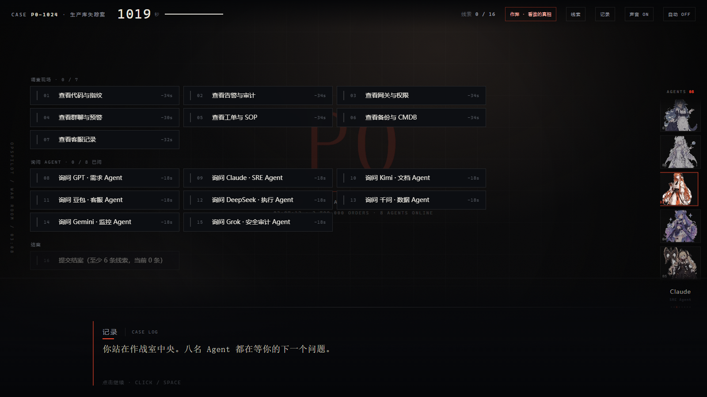

# P0 事故剧本杀 · 谁动了生产库

> 凌晨 3:07:12，生产库 `prod_main` 被 `DROP`。8 个 AI Agent 全都有嫌疑，你只有 **1024 秒**。

一个 Galgame 式的单文件文字推理游戏：审 8 名 AI Agent、翻 16 条互相矛盾的线索、在倒计时归零前指出按下回车的那个人。12 个结局，选错就是别人的锅。

**在线试玩**：https://reserendipity.github.io/p0-murder-mystery/





## 玩法

- 全程点击选项推进，不能自由输入；每个调查 / 提问都会扣除时间
- 线索单条不足以定罪，必须交叉印证（比如「全角标点」同时指向豆包和千问，要靠网关记录排除）
- 拿到线索可以当场向 Agent 出示，逼出破绽；出示错会被挡回
- 结案时指认 1 名嫌疑人 + 选 3 条支撑线索，系统生成复盘报告与结案卡
- 调查顺序、嫌疑人顺序、结案陈述、出示线索**每局洗牌**，无法靠位置预判

## 特点

- **单文件**：`index.html` 一个文件，8 张立绘 base64 内嵌，无 CDN、无外部字体、无音频文件
- **零素材音效**：Web Audio API 实时合成，8 个角色各有独立基频与波形
- **Galgame 演出**：立绘呼吸浮动、打字机、声波条、破绽震动、结局红幕
- **通关解锁**：每打通一个结局写入本地存档，解锁完整真相档案与结局图鉴
- **作弊模式**：顶栏可查看任意 Agent 的「真话 / 假话 / 没说出口的话」，不改变评级
- **移动端可玩**：390px 宽单列布局，按钮 ≥44px 点击区

## 本地运行

直接双击 `index.html` 即可，或：

```bash
python -m http.server 8000
# http://localhost:8000
```

## 开发

源码在 `src/`，构建脚本把模板、样式、剧本与立绘打包成单文件：

```bash
python build.py     # 输出 index.html 与 P0事故剧本杀.html
```

- `src/data.js` —— 角色、线索、结局、真相数据
- `src/scenes.js` —— 序章、调查、八名嫌疑人的问答
- `src/engine.js` —— 状态机、倒计时、打字机、音效、结案卡
- `src/styles.css` —— 视觉与动效

## License

代码以 [Apache License 2.0](LICENSE) 开源。

> 注：8 张角色立绘为第三方同人二创素材，仅用于本 Demo 的演示，版权归原作者所有，不包含在 Apache-2.0 授权范围内。若要商用或再分发，请替换为自己的立绘。
